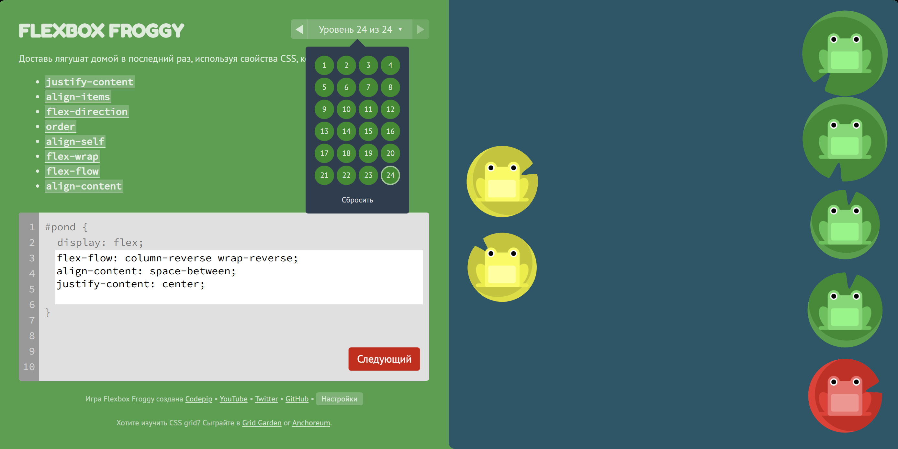
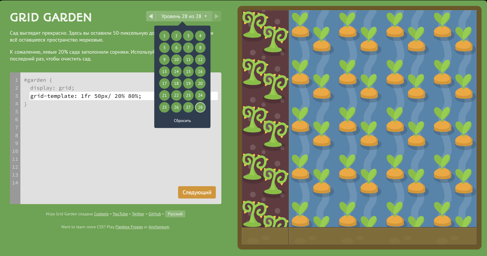
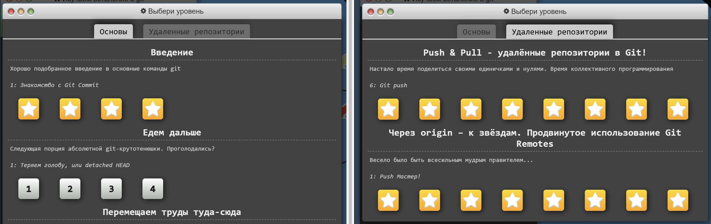

# Отчет по домашней работе 1 "CSS Flexbox, CSS Grid, Git"

**Дисциплина:** Фронт-энд разработка

**Выполнил:** Христофоров Владислав

**Группа:** K3440

**Проверил:** Добряков Д. И.

## Задача

В рамках работы требовалось пройти три игры: Flexbox Froggy, CSS Grid Garden, Learn Git Branching (первые 4 урока + все уроки по удалённым репозиториям), чтобы освоить практические приемы компоновки с применением стандартов CSS Flexbox и CSS Grid, а также изучить Git.

## Ход работы

### Flexbox Froggy

На первом этапе работы пройдены все 24 уровня тренажера Flexbox Froggy. В процессе выполнения отработано выравнивание и распределение элементов вдоль главной и поперечной осей flex-контейнера.

Для позиционирования элементов по главной оси использовано свойство justify-content со значениями flex-start, flex-end, center, space-between, space-around и space-evenly. Выравнивание элементов по поперечной оси выполнено при помощи свойств align-items и align-self. Также отработано изменение направления потока через flex-direction, включен многострочный перенос посредством flex-wrap и скорректировано распределение рядов свойством align-content. Все задания решены без ошибок.

_Рисунок 1 – Экран завершения тренажера Flexbox Froggy с написанным кодом 24-го уровня._

### CSS Grid Garden

На втором этапе выполнено 28 уровней тренажера CSS Grid Garden. В отличие от одномерной модели Flexbox, здесь отработано построение структуры разметки одновременно в двух измерениях: по строкам и по столбцам.

Для позиционирования элементов сетки применены свойства grid-column-start и grid-column-end, а также сокращенная запись grid-column. Аналогичным образом задано поведение по вертикали через grid-row-start, grid-row-end и grid-row. Настроена геометрия контейнера свойствами grid-template-columns и grid-template-rows с использованием долей свободного пространства fr, процентных соотношений и пикселей. Все уровни успешно пройдены.

_Рисунок 2 – Экран завершения 28 уровней тренажера CSS Grid Garden._

### Learn Git Branching

На третьем этапе отработаны сценарии управления историей проекта в симуляторе Learn Git Branching.

Сначала пройден вводный модуль «Основы», включающий фиксацию изменений коммитами, создание веток командой git branch, а также объединение веток методами прямого слияния git merge и линейного переноса git rebase.

Затем выполнены все задания модуля «Удаленные репозитории». Отработана схема взаимодействия с удаленным сервером origin, включая клонирование репозитория командой git clone, скачивание изменений через git fetch, синхронизацию с автоматическим слиянием посредством git pull и отправку коммитов в удаленную ветку с помощью git push. Все обязательные практические уроки завершены.

_Рисунок 3 – Дерево пройденных уровней Learn Git Branching с отметками выполнения._

## Вывод

В ходе работы практически освоены инструменты компоновки веб-интерфейсов CSS Flexbox и CSS Grid. Модель Flexbox показала эффективность при одномерном распределении элементов, а Grid – при формировании двумерных сеточных каркасов страниц. Также закреплены практические навыки ветвления, слияния веток и взаимодействия с удаленными репозиториями Git.
