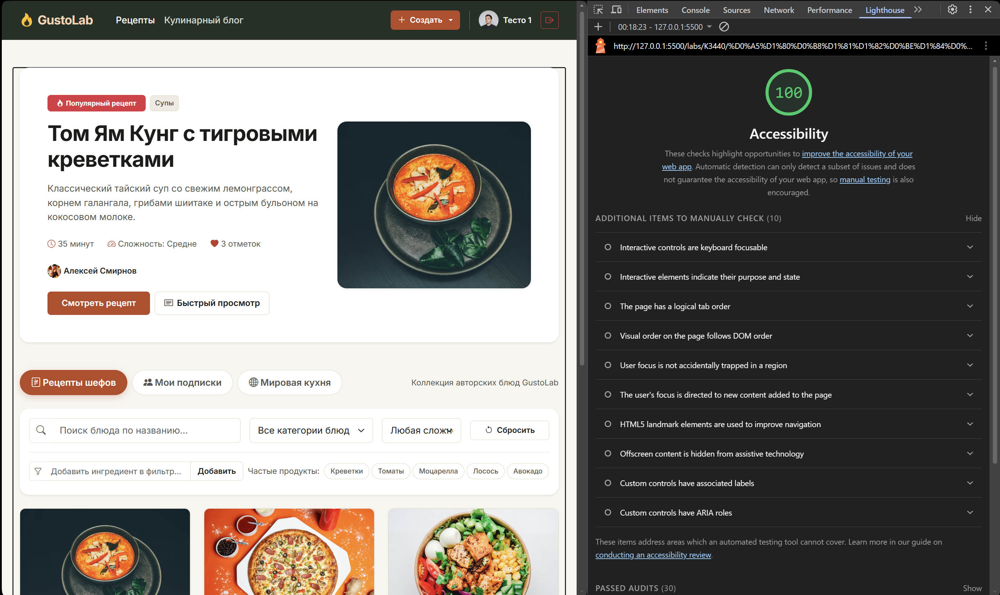
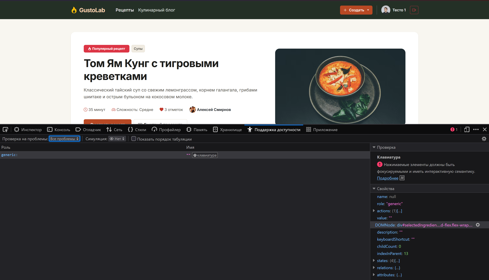

# Отчет по домашней работе 2 "Доступность в HTML"

**Дисциплина:** Фронт-энд разработка

**Выполнил:** Христофоров Владислав

**Группа:** K3440

**Проверил:** Добряков Д. И.

## 1. Задача

Целью домашней работы 2 является аудит и улучшение доступности ранее разработанного веб-приложения «GustoLab», добавление необходимых HTML-атрибутов ко всему контенту на страницах и проверка результатов с помощью инструментов **Firefox DevTools Accessibility** и сервиса **Google Lighthouse**.

## 2. Выполненные улучшения доступности

Для устранения замечаний автоматического аудита и обеспечения навигации с клавиатуры и программ экранного доступа в проекте реализованы следующие изменения:

1. **Навигационные ориентиры и быстрый переход (Skip Link):**
    - На всех 12 экранах добавлена ссылка быстрого перехода к основному содержимому страницы (`.gl-skip-link` $\rightarrow$ `#mainContent` с `tabindex="-1"`), появляющаяся при получении клавиатурного фокуса.
    - Навигационным блокам `<nav>` назначены понятные метки (`aria-label="Основная навигация"`, `aria-label="Хлебные крошки"`), а активным пунктам меню и текущим страницам — атрибут `aria-current="page"`.
2. **Текстовые метки полей, альтернативный текст и доступные имена кнопок (`<label>`, `aria-label`, `alt`):**
    - Всем полям поиска, фильтрации, комментирования, редактирования профиля и динамическим строкам ингредиентов/шагов добавлены связанные элементы `<label for="..." class="visually-hidden">` или видимые `<label for="...">` для устранения предупреждений об отсутствии текстовых меток в Firefox.
    - Чек-лист ингредиентов на странице рецепта переведён на стандартные связки `<input type="checkbox" id="...">` и `<label for="...">` внутри элементов списка `<li>`.
    - Всем кнопкам с иконками (удаление обложек, строк ингредиентов, шагов, комментариев, кнопки изменения порций `-`/`+`, кнопка выхода, быстрый просмотр, удаление тега фильтра) и повторяющимся ссылкам карточек («Открыть», «Читать далее») добавлены уникальные `aria-label`.
    - Декоративные иконочные элементы `<i class="bi ...">` скрыты от скринридеров через `aria-hidden="true"`, а у миниатюр аватаров рядом с именами авторов установлен пустой `alt=""` во избежание дублирования озвучиваемого текста.
3. **ARIA-роли, состояния и области живого обновления (`aria-live`):**
    - Для переключателей вкладок каталога, кулинарного блога и личного кабинета применены роли `role="tablist"`, `role="presentation"` (на промежуточных элементах списка `<li>`), `role="tab"` и `role="tabpanel"` с динамическим обновлением `aria-selected`.
    - Кнопки-переключатели (лайки, закладки, подписки, категории мировой кухни) дополнены атрибутом `aria-pressed`, синхронизируемым при взаимодействии.
    - Для контейнера выбранных тегов фильтрации, счётчика порций, блоков пустого состояния (`role="status"`) и контейнера всплывающих уведомлений настроена область `aria-live="polite"`.
4. **Цветовой контраст, иерархия заголовков и клавиатурный фокус:**
    - Переопределены низкоконтрастные классы `.text-secondary`, `.text-muted` и `.text-danger` на кремовом фоне страницы, а также скорректирован цвет текста в подвале (`.gl-footer-muted`), приглушённых подписей (`--gl-text-muted`) и тегов фильтрации (`.gl-filter-tag`) до соответствия стандарту WCAG AA ($\ge 4.5:1$).
    - Восстановлена последовательная иерархия заголовков (`h1` $\rightarrow$ `h2` $\rightarrow$ `h3`) на всех экранах, карточках и в модальных окнах без пропуска уровней.
    - Добавлено контрастное контурное выделение `:focus-visible` для всех интерактивных элементов и увеличен минимальный размер области нажатия (`28×28 px`) для кнопок редактирования и удаления комментариев.

## 3. Результаты проверки в Google Lighthouse и Firefox DevTools

Проверка проведена на основных типах страниц (главная страница каталога, страница рецепта, кулинарный блог, личный кабинет и формы создания публикаций):

- **Google Lighthouse (Accessibility):** итоговая оценка составила **100 баллов**; замечания по ARIA-структуре вкладок, цветовому контрасту, разметке списка ингредиентов, зонам нажатия кнопок и повторяющимся описаниям ссылок и аватаров полностью устранены.
- **Firefox DevTools Accessibility Inspector:** предупреждения по контрастности текста и отсутствующим текстовым меткам полей ввода полностью устранены; в категории «Клавиатура» сохраняются только информационные уведомления (`ⓘ`) на родительских контейнерах (`div#selectedIngredientsContainer`, `div#commentsList`,...), на которые в JavaScript назначено делегирование событий `click` (фактическими интерактивными элементами внутри них выступают нативно фокусируемые кнопки `<button>` с `aria-label`).

_Рисунок 1 — Результат аудита доступности в Google Lighthouse после внесения правок_

_Рисунок 2 — Проверка дерева доступности и отсутствия замечаний в Firefox DevTools_

## 4. Вывод

В ходе выполнения домашней работы 2 веб-приложение «GustoLab» адаптировано под требования веб-доступности (WCAG 2.1 AA / WAI-ARIA): устранены ошибки вложения ARIA-ролей во вкладках, исправлена контрастность текста на фоне страницы, выстроена логическая иерархия заголовков, добавлены текстовые метки `<label>` и ARIA-состояния для интерактивных компонентов и обеспечена навигация с клавиатуры, что подтверждено инструментами Firefox DevTools и Google Lighthouse.
