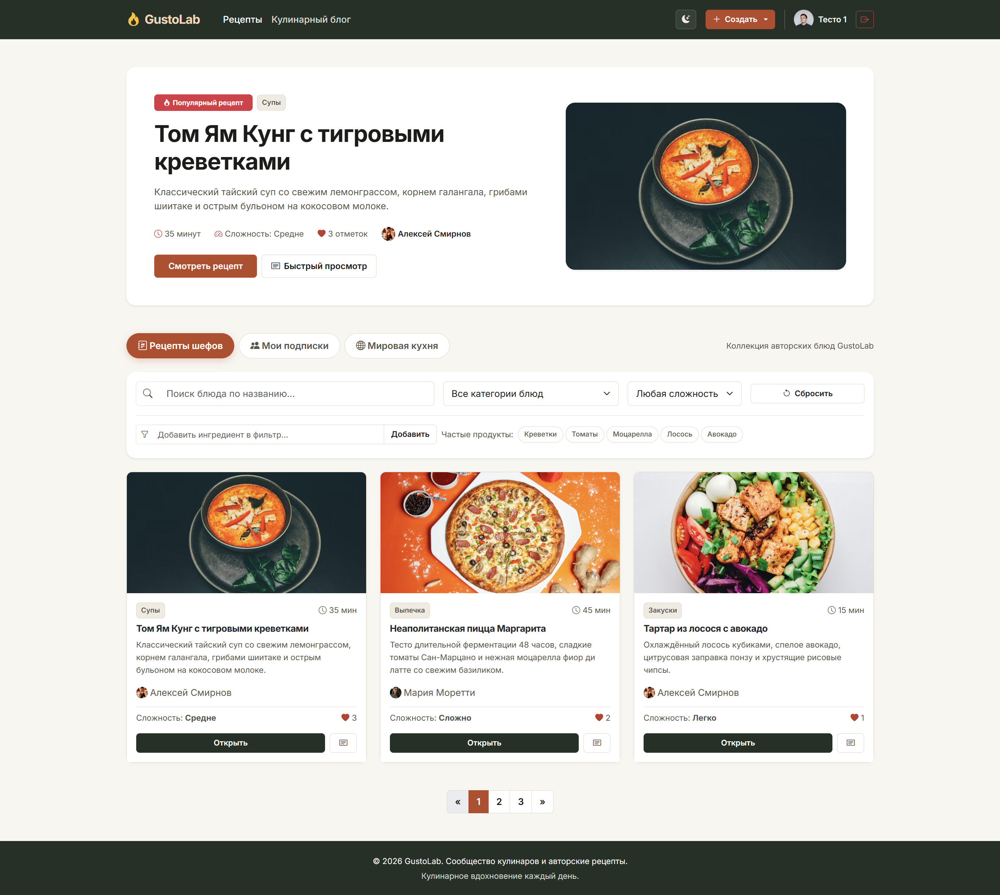

# Отчет по домашней работе 3 "CSS-переменные, темизация сайта средствами CSS"

**Дисциплина:** Фронт-энд разработка

**Выполнил:** Христофоров Владислав

**Группа:** K3440

**Проверил:** Добряков Д. И.

## 1. Задача

Целью домашней работы 3 является реализация темизации (поддержки светлой и тёмной цветовых тем) ранее разработанного веб-приложения «GustoLab» средствами CSS-переменных (Custom Properties) с разделением таблиц стилей тем, учётом системных настроек пользователя и сохранением ручного выбора.

## 2. Реализация темизации средствами CSS и JavaScript

1. **Модульная архитектура таблиц стилей (`css/light.css`, `css/dark.css`, `css/style.css`):**
    - В файл `css/light.css` вынесены CSS-переменные светлой темы (`:root` со свойством `color-scheme: light`): фоновые поверхности (`--gl-bg-body`, `--gl-bg-surface`, `--gl-bg-subtle`, `--gl-bg-muted`), акцентные цвета (`--gl-primary`, `--gl-link`, `--gl-secondary`), границы (`--gl-border`), тени (`--gl-shadow-sm`, `--gl-shadow-md`) и текстовые токены (`--gl-text-primary`, `--gl-text-secondary`, `--gl-text-muted`).
    - В файл `css/dark.css` вынесены значения тех же переменных для тёмной темы (`:root` со свойством `color-scheme: dark`), а также привязка переменных и служебных утилит Bootstrap 5 (`.bg-white`, `.bg-light`, `.alert-light`, `.form-text`, `.text-dark`, `.btn-outline-danger`, `.badge.bg-danger`, `.card`, `.modal-content`, `.form-control`, `.form-select`, `.input-group-text`, `.dropdown-menu`, `.list-group-item`, `.pagination`, `::file-selector-button`) к тёмной палитре с соблюдением контрастности по стандарту WCAG AA ($\ge 4.5:1$).
    - Основной файл `css/style.css` очищен от привязки к конкретным цветам тем и использует исключительно абстрактные переменные `var(--gl-...)` и структурные токены радиусов.
2. **Подключение через медиавыражения и переключатель тем (`js/core/theme.js`, `js/core/auth.js`):**
    - В `<head>` всех 12 HTML-страниц таблицы стилей `light.css` и `dark.css` подключены с атрибутами `media="(prefers-color-scheme: light)"` и `media="(prefers-color-scheme: dark)"`, что обеспечивает автоматический выбор темы в соответствии с настройками операционной системы пользователя при первом открытии сайта.
    - В навигационную панель добавлена кнопка переключения темы `#themeToggleBtn` с обновлением иконки (`bi-moon-stars-fill` / `bi-sun-fill`) и ARIA-атрибутов (`aria-pressed`, `aria-label`).
    - Модуль `js/core/theme.js` при переключении сохраняет выбор в `localStorage` (`gustolab_theme`) и переключает атрибут `media` (`"all"` / `"not all"`) у соответствующих тегов `<link>`, а встроенный в `<head>` скрипт применяет сохранённый `media` до первой отрисовки страницы, исключая мерцание экрана.

## 3. Демонстрация работы тем

_Рисунок 1 — Главная страница каталога «GustoLab» в светлой теме (`light.css`, `media="all"`)_

_Рисунок 2 — Главная страница каталога «GustoLab» в тёмной теме (`dark.css`, `media="all"`)_

## 4. Вывод

В ходе выполнения домашней работы 3 веб-приложение «GustoLab» переведено на модульную двухтемную архитектуру с вынесением CSS-переменных светлой и тёмной тем в отдельные файлы `light.css` и `dark.css`. Реализовано автоматическое определение системной темы через `prefers-color-scheme`, мгновенное переключение тем сменой атрибута `media` без дублирования правил вёрстки и сохранение выбора пользователя в `localStorage`.
