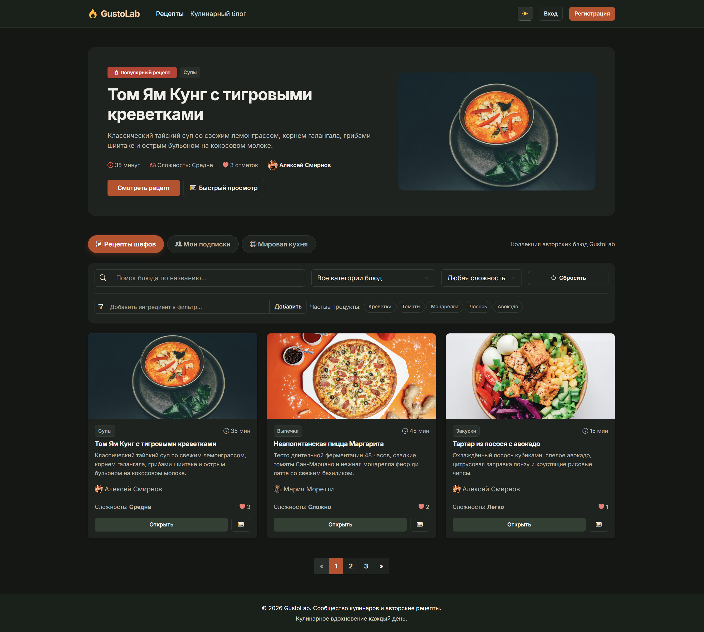

# Отчет по домашней работе 3 "CSS-переменные, темизация сайта средствами CSS"

**Дисциплина:** Фронт-энд разработка

**Выполнил:** Христофоров Владислав

**Группа:** K3440

**Проверил:** Добряков Д. И.

## 1. Задача

Целью домашней работы 3 является реализация темизации (поддержки светлой и тёмной цветовых тем) ранее разработанного веб-приложения «GustoLab» средствами CSS-переменных (Custom Properties) с сохранением пользовательского выбора и учётом системных настроек оформления.

## 2. Реализация темизации средствами CSS и JavaScript

1. **Система дизайн-токенов на CSS Custom Properties (`css/style.css`):**
    - В псевдоклассе `:root` определены базовые переменные светлой темы: фоновые поверхности (`--gl-bg-body`, `--gl-bg-surface`, `--gl-bg-subtle`, `--gl-bg-muted`), акцентные цвета (`--gl-primary`, `--gl-link`, `--gl-secondary`), границы (`--gl-border`), тени (`--gl-shadow-sm`, `--gl-shadow-md`) и цвета текста (`--gl-text-primary`, `--gl-text-secondary`, `--gl-text-muted`).
    - В селекторе `[data-theme="dark"]` переопределены значения всех цветовых токенов под тёмную палитру с сохранением контрастности текста и ссылок по стандарту WCAG AA ($\ge 4.5:1$), а также задано свойство `color-scheme: dark` для корректной стилизации нативных элементов браузера (полос прокрутки и системных контролов).
    - Через медиавыражение `@media (prefers-color-scheme: dark)` для `:root:not([data-theme="light"])` поддержана автоматическая активация тёмной темы при первом визите, если в операционной системе пользователя выбрано тёмное оформление.
    - Компоненты библиотеки Bootstrap 5 (`.bg-white`, `.bg-light`, `.text-dark`, `.btn-outline-danger`, `.badge.bg-danger`, `.card`, `.modal-content`, `.form-control`, `.form-select`, `.input-group-text`, `.dropdown-menu`, `.list-group-item`, `.pagination`) привязаны к CSS-переменным в контексте `[data-theme="dark"]`.
2. **Переключатель тем и сохранение выбора (`js/core/theme.js`, `js/core/auth.js`):**
    - В навигационную панель всех 12 страниц добавлена кнопка переключения темы `#themeToggleBtn` с обновлением иконки (`bi-moon-stars-fill` / `bi-sun-fill`) и ARIA-атрибутов (`aria-pressed`, `aria-label`).
    - Выбранная пользователем тема сохраняется в `localStorage` под ключом `gustolab_theme` и применяется синхронным скриптом сразу при загрузке документа до отрисовки элементов, что исключает мерцание экрана при переходе между страницами.

## 3. Демонстрация работы тем

_Рисунок 1 — Главная страница каталога «GustoLab» в светлой теме (`data-theme="light"`)_

_Рисунок 2 — Главная страница каталога «GustoLab» в тёмной теме (`data-theme="dark"`)_

## 4. Вывод

В ходе выполнения домашней работы 3 веб-приложение «GustoLab» переведено на двухтемную цветовую схему с использованием CSS-переменных. Реализовано мгновенное переключение между светлой и тёмной темами без дублирования правил вёрстки, поддержка системной темы через `prefers-color-scheme` и сохранение пользовательского выбора в `localStorage`.
