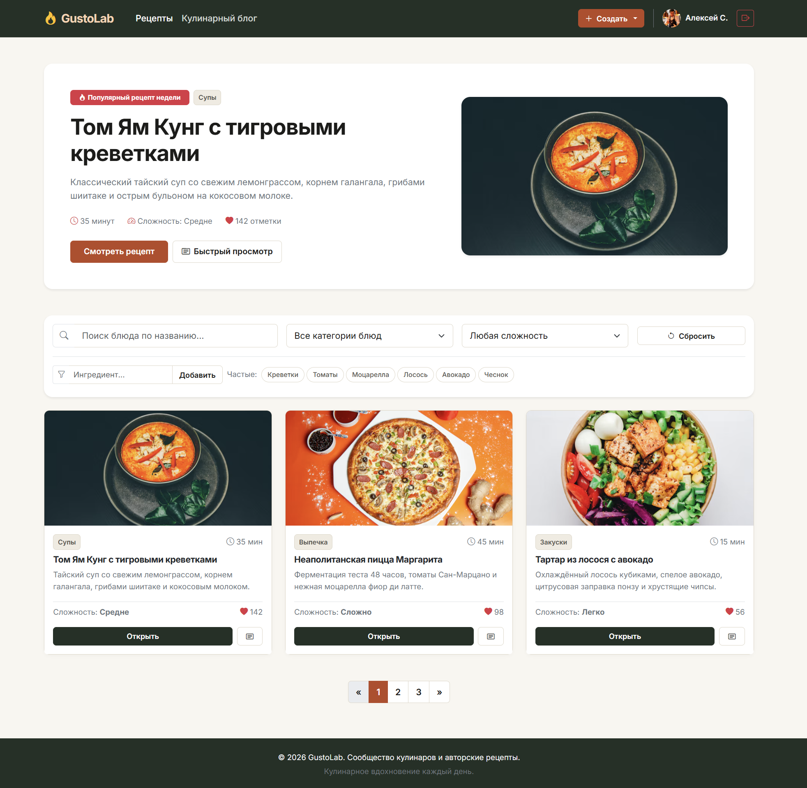
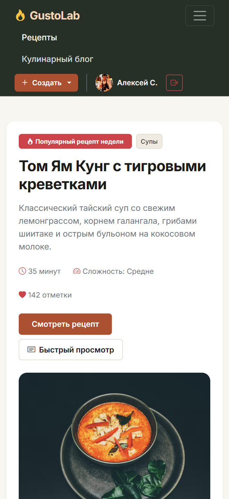
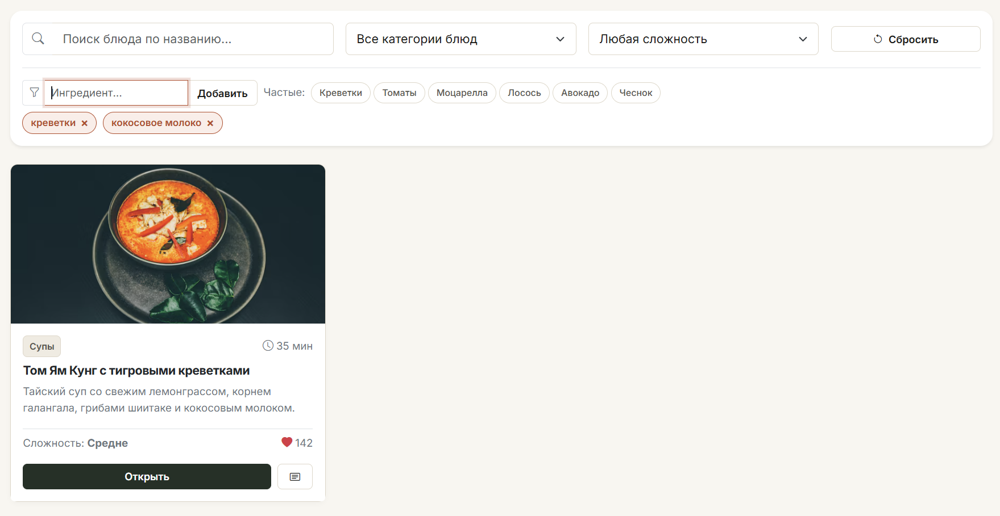
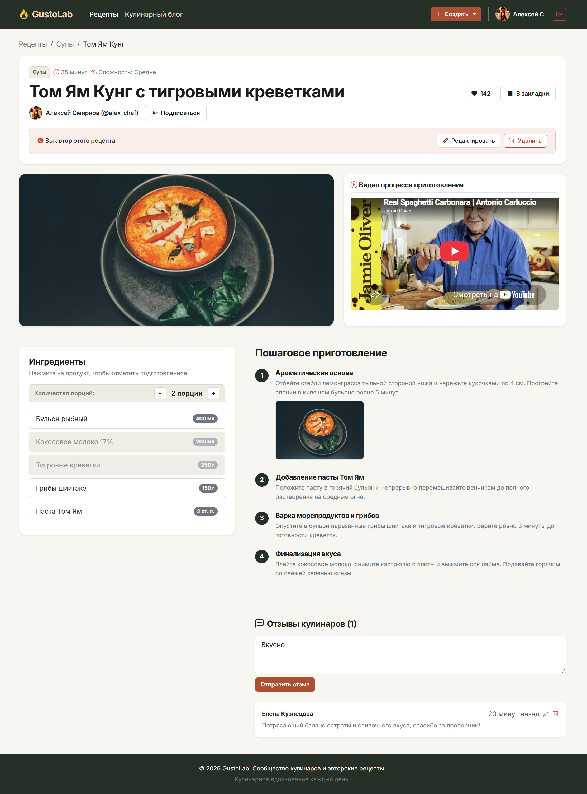
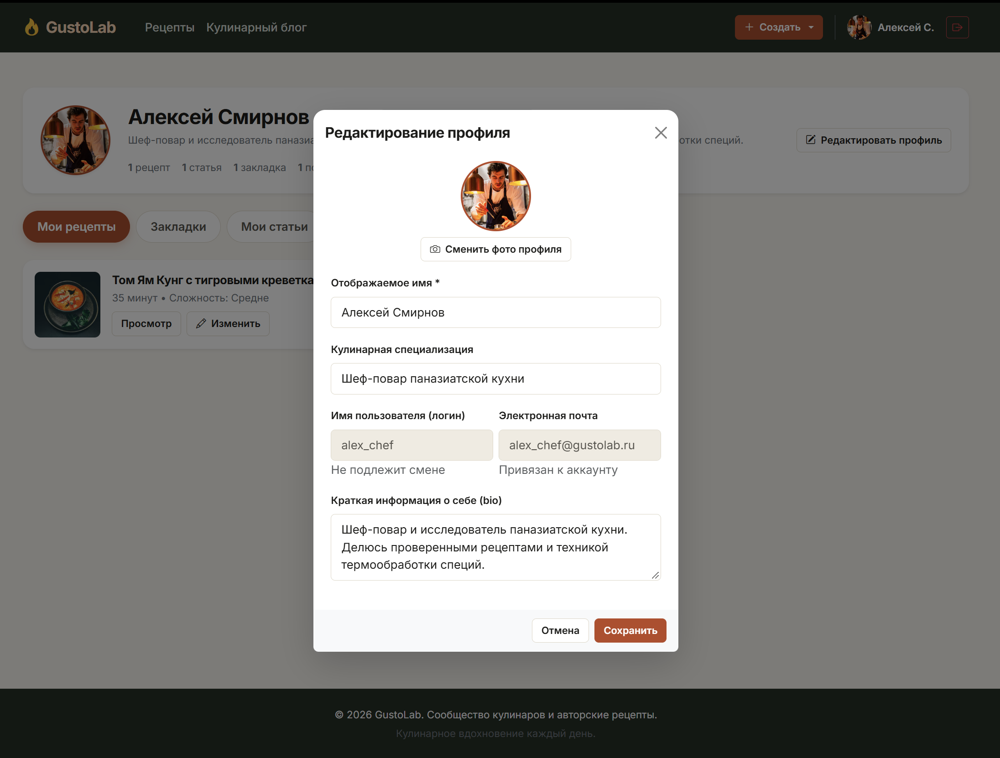

# Отчет по лабораторной работе 1 "Верстка сайта средствами HTML, CSS и Bootstrap"

**Дисциплина:** Фронт-энд разработка

**Выполнил:** Христофоров Владислав

**Группа:** K3440

**Проверил:** Добряков Д. И.

## 1. Задача

Целью работы является освоение и практическое закрепление навыков проектирования семантической структуры веб-приложений с использованием спецификации HTML5, построения адаптивных пользовательских интерфейсов средствами CSS3 и библиотеки Bootstrap 5, а также программирования модульной клиентской интерактивности на нативном языке JavaScript без применения сторонних фреймворков и сборщиков.

В соответствии с вариантом 5 («Сервис для обмена рецептами и кулинарных блогов») поставлены следующие инженерные задачи:

1. Спроектировать архитектуру и сверстать многостраничный пользовательский интерфейс сервиса, включающий как обязательные базовые экраны (витрина каталога рецептов, детальный просмотр рецепта, личный кабинет пользователя, формы авторизации и регистрации), так и вспомогательные экраны жизненного цикла контента (конструктор создания и форма редактирования рецепта, лента и детальный просмотр кулинарного блога, формы создания и редактирования статей, страница публичного портфолио автора).
2. Реализовать адаптивную верстку с использованием 12-колоночной сетки и компонентов библиотеки Bootstrap 5, обеспечивающую устойчивое отображение на смартфонах, планшетах и широкоформатных мониторах.
3. Разработать функционал поиска с одновременной многофакторной фильтрацией каталога по четырем критериям: названию блюда, категории (типу блюда), уровню кулинарной сложности и динамическому набору ингредиентов.
4. Интегрировать диалоговые модальные окна для реализации вспомогательных сценариев: быстрого просмотра характеристик блюда, редактирования учетных данных профиля и модальных окон подтверждения деструктивных операций (удаление рецепта, статьи, комментария, аккаунта).
5. Разработать модульную клиентскую логику на нативном JavaScript (манипуляции с DOM-деревом, пропорциональный калькулятор порций с правильным склонением числительных, интерактивный чек-лист подготовки продуктов, инлайн-редактирование комментариев, предпросмотр медиафайлов, синхронизация реакций и счетчиков).

## 2. Документация архитектуры и спецификация экранов сервиса

### 2.1. Структура файлов и каталогов проекта

Файловая структура проекта организована по модульному принципу без внешних систем сборки, что обеспечивает автономный запуск веб-приложения любым статическим сервером:

```
lab1/
├── index.html               # Витрина каталога рецептов с фильтрацией
├── recipe.html              # Детальный просмотр рецепта и готовка
├── create-recipe.html       # Конструктор создания нового рецепта
├── edit-recipe.html         # Форма редактирования существующего рецепта
├── blog.html                # Лента статей и гастрономических заметок
├── blog-post.html           # Детальный просмотр статьи блога с обсуждением
├── create-blog-post.html    # Форма публикации статьи в блог
├── edit-blog-post.html      # Форма редактирования статьи
├── author.html              # Публичный профиль шеф-повара (портфолио)
├── profile.html             # Личный кабинет текущего пользователя
├── login.html               # Экран входа в систему (авторизация)
├── register.html            # Экран регистрации нового кулинара
├── css/
│   └── style.css            # Дизайн-система, CSS-переменные, кастомные компоненты
├── js/
│   └── main.js              # Единый клиентский модуль интерактивности
└── img/                     # Графические ассеты и иллюстрации для отчета
    ├── catalog.png
    ├── recipe.png
    ├── quick-view.png
    └── profile.png
```

### 2.2. Спецификация и назначение страниц веб-приложения

Интерфейс веб-приложения декомпозирован на 12 функциональных экранов, объединенных в сквозные пользовательские сценарии:

#### 1. Каталог кулинарных рецептов (`index.html`)

- **Назначение:** Главный экран сервиса, выполняющий роль интерактивной витрины доступных блюд.
- **Ключевые блоки и элементы:**
  - Сквозная навигационная панель (`.gl-navbar`) с логотипом GustoLab, ссылками на разделы, выпадающим меню «+ Создать» и блоком профиля шефа.
  - Промо-карточка популярного рецепта недели («Том Ям Кунг») с подробными метаданными и кнопками прямого перехода или быстрого просмотра.
  - Панель фильтрации: текстовое поле поиска по названию, выпадающие списки выбора категории (`dish_types`) и сложности (`difficulty`), а также кнопка сброса параметров.
  - Модуль теговой фильтрации ингредиентов (Tag Input): поле ввода с автодополнением из справочника `<datalist>`, кнопки быстрых популярных продуктов и динамический контейнер выбранных тегов с кнопками удаления (`×`).
  - Адаптивная трехколоночная сетка карточек рецептов (`.recipe-item`) с метаданными (время, сложность, лайки), кнопкой перехода к рецепту и триггером модального окна быстрого просмотра.
  - Блок пустого состояния (`#recipesEmptyState`), автоматически активирующийся при отсутствии совпадений по фильтрам.
  - Элемент постраничной навигации (пагинация).
  - Всплывающее модальное окно быстрого просмотра характеристик блюда (`#quickViewModal`).

#### 2. Просмотр рецепта и интерактивная готовка (`recipe.html`)

- **Назначение:** Детальный экран рецепта, ориентированный на процесс приготовления блюда и социальное взаимодействие.
- **Ключевые блоки и элементы:**
  - Навигационная цепочка («хлебные крошки») для возврата в каталог.
  - Заголовочная карточка: категория, время термообработки, сложность, имя автора со ссылкой на его публичный профиль (`author.html`) и интерактивной кнопкой подписки.
  - Блок социальных реакций: переключаемые кнопки «Нравится» (с инкрементом счетчика) и «В закладки».
  - Панель управления автора: блок с кнопками перехода к редактированию (`edit-recipe.html`) и вызова модального окна удаления блюда (`#deleteRecipeModal`).
  - Медиа-секция: фотография готового блюда и адаптивный контейнер плеера видеоинструкции (`ratio ratio-16x9`).
  - Плавающий сайдбар ингредиентов (`sticky-top`): интерактивный калькулятор изменения количества порций (`[-] / [+]`) с автоматическим пересчетом граммовок и чек-лист продуктов с вычеркиванием подготовленных позиций по клику.
  - Нумерованный список пошагового приготовления с текстовыми инструкциями и иллюстрациями этапов.
  - Секция комментариев: форма добавления нового отзыва, список опубликованных комментариев с поддержкой инлайн-редактирования текста прямо в карточке и вызовом модального окна удаления (`#deleteCommentModal`).

#### 3. Конструктор публикации нового рецепта (`create-recipe.html`)

- **Назначение:** Экран публикации авторского кулинарного рецепта.
- **Ключевые блоки и элементы:**
  - Кнопка возврата в каталог («← Назад в каталог»).
  - Поля ввода названия блюда, расширенного описания, селект сложности приготовления и числовое поле времени готовки в минутах.
  - Компонент загрузки медиа (`.gl-upload-zone`): область drag-and-drop с кнопкой выбора файла с диска, валидацией форматов изображений и локальным превью через `FileReader`.
  - Поле ввода ссылки на видеоурок на внешнем видеохостинге.
  - Динамический блок ингредиентов: таблица с возможностью добавления неограниченного числа строк («+ Добавить продукт»), полями ввода названия, количества и строгого выбора единицы измерения (`g`, `ml`, `pcs`, `tbsp`, `tsp`), а также кнопками удаления строк.
  - Динамический блок шагов приготовления: карточки шагов с кнопкой добавления («+ Добавить шаг»), текстовой инструкцией, загрузкой фотографии конкретного этапа и автоматической сквозной перенумерацией при удалении любого шага.

#### 4. Редактирование существующего рецепта (`edit-recipe.html`)

- **Назначение:** Полный цикл обновления ранее опубликованного кулинарного рецепта.
- **Ключевые блоки и элементы:**
  - Предзаполненные поля заголовка, описания, времени, уровня сложности и ссылки на видео.
  - Зона замены главной фотографии с отображением текущей обложки и кнопкой загрузки нового файла.
  - Полноценные динамические секции ингредиентов и пошаговых руководств, предзаполненные исходными данными рецепта с возможностью редактирования текстов, смены единиц измерения, добавления и удаления элементов.
  - Кнопка вызова модального окна подтверждения удаления рецепта.

#### 5. Лента кулинарного блога (`blog.html`)

- **Назначение:** Агрегатор кулинарных статей, заметок о специях и технологиях приготовления.
- **Ключевые блоки и элементы:**
  - Сквозная авторизованная шапка сайта с активной вкладкой «Кулинарный блог».
  - Панель поиска статей по ключевым словам в заголовках.
  - Вертикальный список карточек публикаций (`.blog-card`): обложка, имя и аватар автора, дата статьи, анонс текста, счетчики лайков и комментариев, ссылка на чтение.
  - Блок пустого состояния при отсутствии найденных статей (`#blogEmptyState`).
  - Постраничная навигация.

#### 6. Просмотр статьи блога (`blog-post.html`)

- **Назначение:** Экран чтения статьи блога с полнотекстовым материалом и веткой комментариев.
- **Ключевые блоки и элементы:**
  - Кнопка контекстного возврата в блог («← Назад в блог»).
  - Полный текст статьи с подзаголовками, типографикой и широкоформатной обложкой.
  - Блок профиля автора публикации с кнопкой подписки и кнопка отметки «Нравится» с динамическим счетчиком.
  - Панель автора с кнопками быстрого перехода к редактированию статьи (`edit-blog-post.html`) и модальным окном удаления публикации (`#deleteBlogModal`).
  - Обсуждение публикации: форма комментирования и список комментариев с инлайн-редактированием и модальным окном подтверждения удаления.

#### 7. Создание статьи блога (`create-blog-post.html`)

- **Назначение:** Публикация текстового материала в блог.
- **Ключевые блоки и элементы:**
  - Поля ввода заголовка публикации, многострочное поле текста (`<textarea rows="8">`) и зона выбора файла обложки с локальным превью.

#### 8. Редактирование статьи блога (`edit-blog-post.html`)

- **Назначение:** Корректировка заголовка и содержимого ранее опубликованной статьи.
- **Ключевые блоки и элементы:**
  - Предзаполненная форма изменения текста публикации с валидацией и кнопками отмены или сохранения.

#### 9. Публичный профиль шеф-повара (`author.html`)

- **Назначение:** Экран портфолио автора, доступный другим кулинарам сообщества.
- **Ключевые блоки и элементы:**
  - Карточка автора: большой аватар, имя, никнейм (`@alex_chef`), развернутая биография, счетчики опубликованных рецептов, статей и количества подписчиков.
  - Интерактивная кнопка подписки/отписки (`.author-sub-btn`), синхронно изменяющая текст («Подписаться на автора» / «Вы подписаны») и число подписчиков в реальном времени.
  - Вкладка рецептов конкретного автора со ссылками на детальный просмотр.
  - Вкладка статей конкретного автора.
  - Информационная плашка со специализацией шефа.

#### 10. Личный кабинет пользователя (`profile.html`)

- **Назначение:** Персональный центр управления активностью и учетной записью текущего шефа.
- **Ключевые блоки и элементы:**
  - Карточка пользователя: аватар, имя, логин, специализация, биография, суммарные счетчики публикаций, закладок и социальных связей.
  - Кнопка вызова модального окна редактирования профиля (`#editProfileModal`).
  - Система вкладок (Bootstrap Tabs / `.nav-pills`):
    - **«Мои рецепты»:** карточки собственных блюд с кнопками быстрого перехода и редактирования.
    - **«Закладки»:** сохраненные рецепты других авторов с возможностью удаления из избранного.
    - **«Мои статьи»:** созданные публикации блога с кнопками управления.
    - **«Подписки»:** список авторов, за которыми следит пользователь, с активными кнопками быстрой отписки.
    - **«Подписчики»:** список пользователей, подписанных на данный аккаунт, с кнопками взаимной подписки.
    - **«Настройки»:** раздел управления безопасностью, включающий панель удаления учетной записи с модальным окном подтверждения (`#deleteAccountModal`).
  - Модальное окно редактирования данных профиля (`#editProfileModal`): интерактивная смена фотографии профиля через выбор файла с мгновенным обновлением аватара, поля изменения имени, кулинарной специализации, биографии, а также информационные поля логина и email в режиме только для чтения.

#### 11. Авторизация в системе (`login.html`)

- **Назначение:** Экран входа пользователя в существующий аккаунт.
- **Ключевые блоки и элементы:**
  - Облегченная гостевая навигационная панель (только логотип и кнопка «Регистрация»).
  - Центрированная карточка формы с валидацией полей электронной почты (`type="email"`) и пароля (`type="password"`), кнопка отправки и ссылка на экран регистрации.

#### 12. Регистрация нового кулинара (`register.html`)

- **Назначение:** Экран регистрации нового аккаунта шеф-повара.
- **Ключевые блоки и элементы:**
  - Гостевая шапка с кнопкой «Вход».
  - Форма ввода имени пользователя, адреса электронной почты и пароля с валидацией минимальной длины (`minlength="6"`).

### 2.3. Спецификация дизайн-системы и визуальных токенов (`css/style.css`)

Для исключения хаотичной стилизации и обеспечения стилистической целостности на всех экранах сформирована система CSS-переменных и изолированных компонентов с префиксом `.gl-`:

- **Цветовая палитра:**
  - Акцентный кулинарный цвет: `--gl-primary: #b84924` (терракотовый);
  - Фоновый цвет шапки и подвала: `--gl-secondary: #243026` (глубокий графитово-оливковый);
  - Цвет общего фона страниц: `--gl-bg-body: #f8f6f0` (теплый кремовый);
  - Цвет поверхностей карточек и панелей: `--gl-bg-surface: #ffffff`;
  - Вспомогательный цвет подложек: `--gl-bg-subtle: #f0ebe1`;
  - Цвет границ и разделителей: `--gl-border: #ded7c8`;
  - Цвет основного текста: `--gl-text-primary: #1c1c1a`;
  - Цвет сигналов деструктивных действий и лайков: `--gl-danger: #c0392b`.
- **Доступность и контраст:** Все цветовые пары «текст/фон» удовлетворяют стандарту WCAG AA с коэффициентом контрастности не менее $4.5:1$ (для белого текста на терракотовом фоне – $4.8:1$, для темно-угольного на кремовом фоне – $11.6:1$).
- **Компонентные классы:**
  - `.gl-btn`, `.gl-btn-primary`, `.gl-btn-outline`, `.gl-btn-danger`, `.gl-btn-sm` – унифицированные кнопки с инкапсулированными внутренними отступами и hover-эффектами;
  - `.gl-toggle-btn` – интерактивные кнопки состояний с изолированными модификаторами `.active-like`, `.active-save` и `.active-sub`, предотвращающими нежелательное переопределение цветов текста;
  - `.gl-filter-tag` и `.gl-quick-tag` – компоненты теговой фильтрации;
  - `.gl-card`, `.gl-card-img` – карточки каталога с плавным эффектом подъема при наведении;
  - `.gl-ingredient-item` – строка списка ингредиентов с поддержкой зачеркивания (`.checked`).
- **Переопределение компонентов Bootstrap:** Полностью нейтрализованы стандартные синие стили Bootstrap. Для вкладок `.nav-pills .nav-link.active` назначен фирменный терракотовый цвет, для полей ввода – терракотовое кольцо фокусировки (`box-shadow`), а заголовки красных шапок модальных окон зафиксированы снежно-белым цветом селектором повышенной специфичности `.modal-header.bg-danger .modal-title { color: #ffffff !important; }`.

## 3. Ход работы

### 3.1. Семантическая структура страниц и навигация (HTML5)

На первом этапе выполнена верстка 12 страниц веб-приложения на базе стандарта HTML5. Для логического структурирования применены специализированные теги:

- `<header>` – сквозные шапки с навигационными панелями;
- `<nav>` – навигационные цепочки (хлебные крошки) и блоки переходов;
- `<main>` – уникальное основное содержимое каждого экрана;
- `<section>` – тематические секции (фильтры, списки шагов, комментарии);
- `<article>` – самостоятельные смысловые карточки рецептов и статей;
- `<footer>` – подвалы страниц с информационными данными.

Навигация разделена на два устойчивых контура:

1. **Гостевой контур** на экранах входа (`login.html`) и регистрации (`register.html`), содержащий логотип и кнопку перехода к альтернативной форме.
2. **Авторизованный контур** на остальных 10 страницах сервиса, содержащий логотип GustoLab, ссылки «Рецепты» и «Кулинарный блог», выпадающее меню добавления контента («+ Создать»), блок текущего шефа с аватаром и ссылку безопасного выхода из учетной записи.

Контекстные кнопки возврата назад («← Назад в каталог», «← Назад в блог») и цепочки хлебных крошек вынесены непосредственно в контентную область страниц под шапку. Формы снабжены явным связыванием `<label for="...">` с идентификаторами полей, а также встроенными валидаторами форматов (`type="email"`, `type="number"`, `min="1"`, `required`).

Общая семантическая структура главной страницы сервиса со сквозной шапкой авторизованного кулинара, промо-блоком и навигационными ориентирами представлена на рисунке 1.



_Рисунок 1 – Главная страница каталога рецептов: семантическое зонирование и навигация_

### 3.2. Адаптивная компоновка и стилизация (Bootstrap 5 и кастомный CSS)

На втором этапе реализована адаптивная компоновка веб-интерфейса. Для обеспечения устойчивого отображения на мобильных телефонах, планшетах и мониторах высокой четкости использована 12-колоночная адаптивная сетка Bootstrap 5 с классами `container`, `row`, `col-12`, `col-md-6`, `col-lg-4` и утилитами позиционирования Flexbox.

В интерфейс интегрированы компоненты библиотеки Bootstrap 5:

- сворачиваемое адаптивное мобильное меню (`navbar-toggler`, `collapse`), трансформирующее горизонтальную навигационную панель в компактное меню-гамбургер;
- многоколоночные сетки каталога (`row-cols-1 row-cols-md-2 row-cols-lg-3`), автоматически выстраивающие карточки в один столбец на узких экранах;
- адаптивное встраивание медиаконтента с сохранением пропорций $16:9$ через класс `ratio ratio-16x9`.

Особое внимание уделено поведению макета на экранах смартфонов: на мобильных устройствах горизонтальные отступы оптимизируются, боковые плавающие панели переходят в естественный вертикальный поток документа, а элементы управления получают увеличенную площадь касания (не менее $44 \times 44\text{px}$) для комфортного сенсорного взаимодействия.

Поведение адаптивной сетки и сворачивание навигационного меню в гамбургер при эмуляции экрана мобильного устройства продемонстрировано на рисунке 2.



_Рисунок 2 – Адаптивное отображение интерфейса на мобильном устройстве_

### 3.3. Реализация требования варианта: поиск и многофакторная фильтрация

На третьем этапе в файле `js/main.js` разработан алгоритм многофакторной фильтрации каталога в строгом соответствии с заданием варианта 5.

Фильтрация учитывает одновременно 4 критерия:

1. **Поиск по названию блюда:** поле ввода перехватывает событие `input` и выполняет регистронезависимый поиск по подстроке названия (`data-title`).
2. **Фильтрация по типу блюда:** селект выбора категории сопоставляется со значением `data-category` («Супы», «Выпечка», «Закуски» и др.).
3. **Фильтрация по сложности:** селект выбора уровня кулинарной сложности сопоставляется со значением `data-difficulty` (`easy`, `medium`, `hard`).
4. **Масштабируемая теговая фильтрация ингредиентов (Tag Input):** пользователь может ввести наименование любого продукта в инпут с подсказками из `<datalist>` или нажать на быстрый чипс популярного ингредиента («Креветки», «Томаты», «Моцарелла», «Лосось», «Авокадо», «Чеснок»). Выбранный продукт заносится в структуру данных `Set`, а в интерфейсе формируется визуальный тег с кнопкой удаления `[Продукт ×]`.

Алгоритм функции `filterRecipes()` выполняет одновременную проверку пересечения всех условий:

```javascript
const isVisible = matchSearch && matchCat && matchDiff && matchIngredients;
card.style.display = isVisible ? "block" : "none";
```

Если рецепт не содержит хотя бы одного из выбранных тегов ингредиентов, он скрывается. При отсутствии совпадений автоматически активируется блок пустого состояния (`#recipesEmptyState`), а кнопка «Сбросить» возвращает значения селектов, инпутов и структуру выбранных тегов к исходному состоянию.

Внешний вид модуля фильтрации с активными тегами продуктов и динамически отфильтрованной выдачей карточек приведен на рисунке 3.



_Рисунок 3 – Работа модуля многофакторной фильтрации каталога с теговым вводом ингредиентов_

### 3.4. Клиентская интерактивность на JavaScript и модальные окна

На четвертом этапе разработана интерактивная клиентская логика веб-приложения на нативном JavaScript (файл `js/main.js`):

- **Калькулятор порций:** на странице рецепта реализован масштабируемый пересчет ингредиентов. Кнопки `[-]` и `[+]` изменяют значение порций от 1 до 16. Количество каждого продукта пересчитывается по формуле $\text{scaled} = \frac{\text{base}}{\text{baseServings}} \cdot \text{currentServings}$, а число сопровождается грамматическим склонением слова («порция», «порции», «порций»).
- **Чек-лист подготовки продуктов:** клик по строке ингредиента переключает класс `.checked`, позволяя кулинару визуально вычеркивать подготовленные продукты.
- **Инлайн-редактирование отзывов:** при нажатии на иконку редактирования комментария текст абзаца прямо в карточке заменяется на поле `<textarea>` с кнопками «Сохранить» и «Отмена» без вызова блокирующих модальных окон браузера `prompt()`.
- **Предпросмотр файлов через `FileReader`:** при выборе фото аватара в профиле или обложки рецепта файл считывается через `reader.readAsDataURL(file)`, мгновенно отображая превью в интерфейсе.
- **Динамические строки форм:** в формах создания и редактирования рецептов реализовано добавление и удаление строк ингредиентов и шагов с автоматической перенумерацией этапов.

Интерактивные элементы страницы рецепта – калькулятор порций, зачеркивание подготовленных ингредиентов и блок отзывов – представлены на рисунке 4.



_Рисунок 4 – Детальная страница рецепта с интерактивным калькулятором порций и чек-листом_

Для реализации вспомогательных сценариев в систему внедрены модальные диалоговые окна Bootstrap Modal:

- **Модальное окно быстрого просмотра (`#quickViewModal`):** клик по кнопке быстрого просмотра карточки считывает параметры блюда из data-атрибутов (`data-title`, `data-time`, `data-difficulty`, `data-ingredients`) и отображает карточку без перезагрузки экрана;
- **Модальное окно редактирования профиля (`#editProfileModal`):** предоставляет интерфейс изменения имени, специализации, биографии и мгновенной замены фото профиля;
- **Модальные окна подтверждения деструктивных операций:** стилизованные диалоговые окна с контрастными заголовками на красном фоне для безопасного удаления рецептов (`#deleteRecipeModal`), статей блога (`#deleteBlogModal`), комментариев (`#deleteCommentModal`) и учетной записи шефа (`#deleteAccountModal`).

Интерфейс личного кабинета с системой вкладок активности и открытым модальным диалоговым окном редактирования профиля показан на рисунке 5.



_Рисунок 5 – Личный кабинет пользователя и модальное окно редактирования профиля_

## 4. Вывод

В ходе выполнения лабораторной работы 1 освоены практические методы семантической верстки веб-приложений на базе HTML5, построения адаптивных макетов с помощью 12-колоночной сетки и компонентов Bootstrap 5, а также проектирования модульной клиентской логики на нативном JavaScript.

В соответствии с заданием варианта 5 спроектирован и задокументирован 12-страничный веб-сервис для обмена рецептами и ведения кулинарных блогов GustoLab. В полном объеме реализовано ключевое требование варианта – многофакторная фильтрация каталога одновременно по названию, типу блюда, сложности приготовления и составу входящих ингредиентов с теговым вводом. Интерфейс снабжен авторской гастрономической дизайн-системой, модальными окнами Bootstrap и интерактивными клиентскими модулями (калькулятор порций с падежами, чек-листы, инлайн-редактирование, локальный предпросмотр медиафайлов). Верстка адаптирована под различные типы клиентских устройств и полностью подготовлена к последующей интеграции с внешним API.
