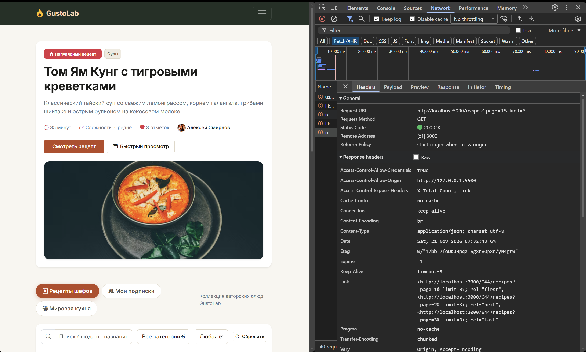
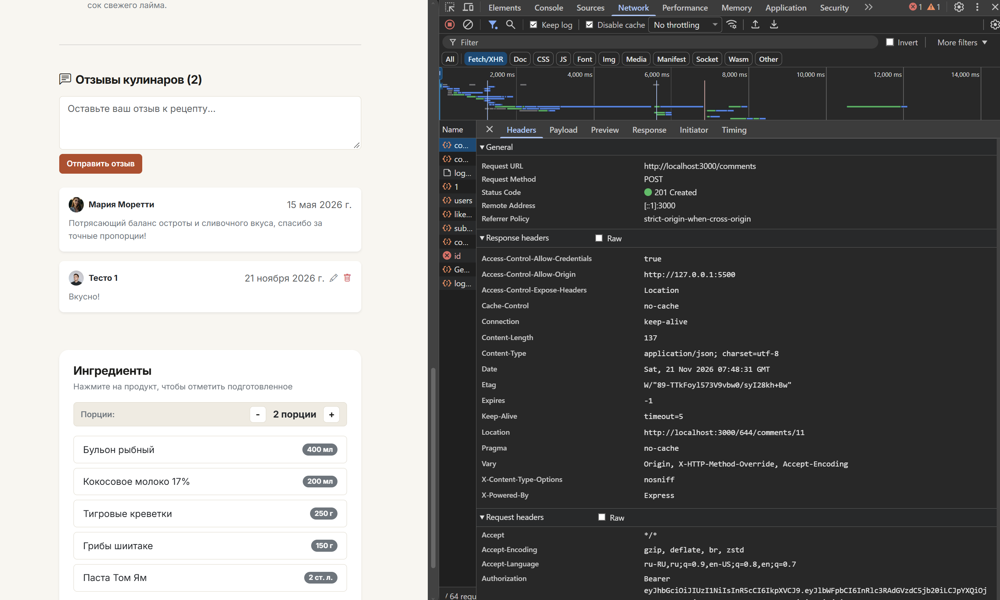
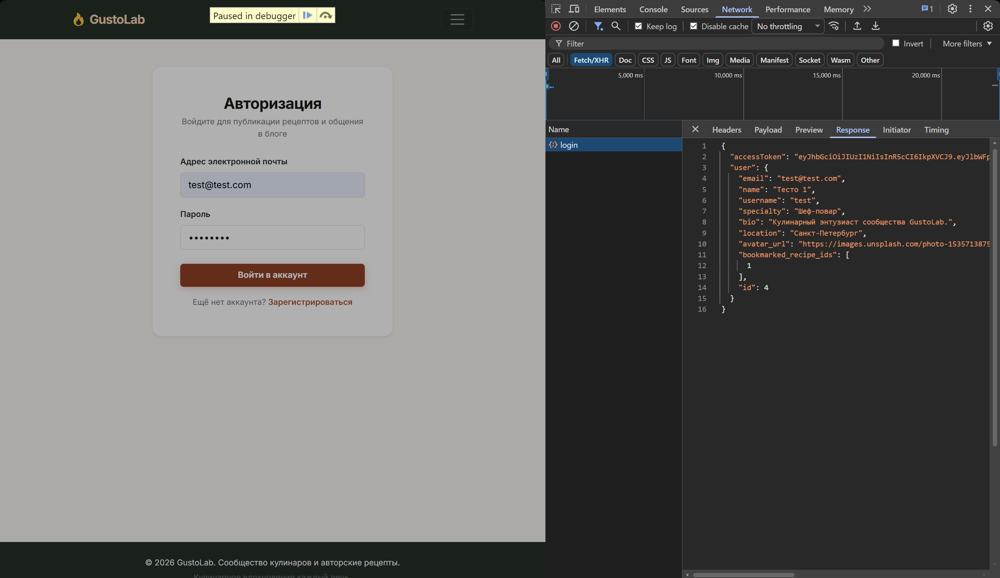
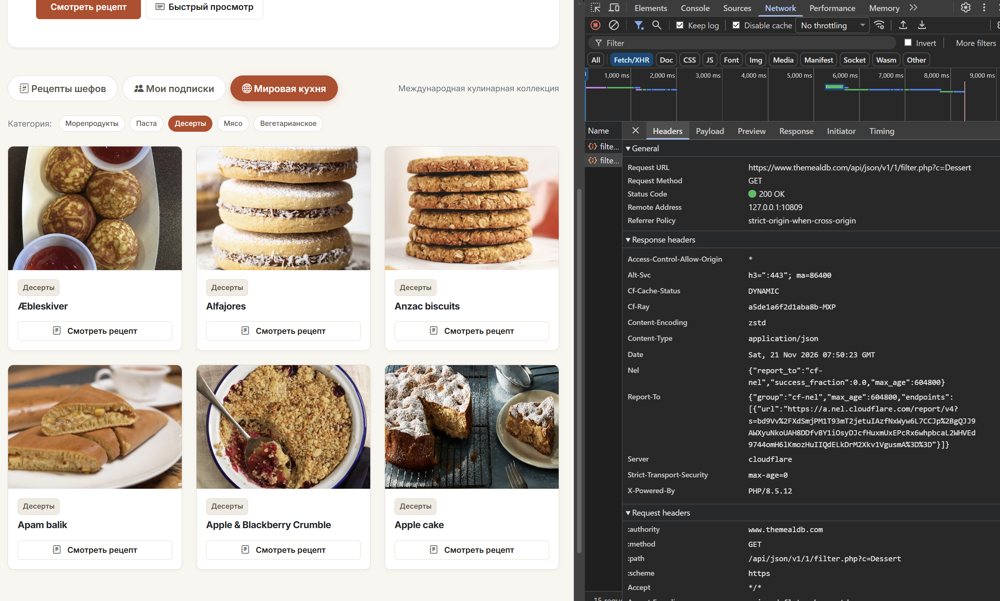

# Отчет по лабораторной работе 2 "Взаимодействие с внешним API"

**Дисциплина:** Фронт-энд разработка

**Выполнил:** Христофоров Владислав

**Группа:** K3440

**Проверил:** Добряков Д. И.

## 1. Задача

Целью работы является привязка клиентского веб-приложения из лабораторной работы 1 к внешнему API средствами JavaScript (в рамках реализации выбран нативный Fetch API), работа с форматом обмена данными JSON, реализация мокового REST API с помощью `json-server` и подключение аутентификации и авторизации пользователей.

В соответствии с заданием лабораторной работы 2 и вариантом 5 («Сервис для обмена рецептами и кулинарных блогов») поставлены следующие задачи:

1. Развернуть локальный mock-сервер REST API на базе `json-server` и `json-server-auth` и спроектировать структуру данных `db.json` для сущностей варианта 5 (пользователи, рецепты, статьи блога, комментарии, лайки и подписки).

2. Подключить клиентскую часть веб-приложения, разработанную в лабораторной работе 1, к локальному REST API с помощью `fetch` и `async/await`, заменив статическую разметку на динамическую загрузку данных с сервера.

3. Реализовать аутентификацию и авторизацию пользователей (вход, регистрацию, хранение токена и разграничение доступа для гостей и авторизованных пользователей).

4. Обеспечить выполнение операций создания, просмотра, редактирования и удаления данных (рецептов, статей, комментариев и реакций), а также сохранить функциональность варианта 5 — поиск и фильтрацию рецептов по названию, категории, сложности и ингредиентам.

5. Подключить открытый внешний веб-сервис (TheMealDB API) для получения реальных данных со стороннего сервера.

## 2. Документация архитектуры, модулей и эндпоинтов сервиса

### 2.1. Структура файлов и каталогов проекта

Проект размещён в изолированном каталоге `lab2/`. Вторичные страницы сгруппированы в директории `pages/`, а клиентский код организован на базе нативных ES-модулей (`<script type="module">`), благодаря чему к каждой HTML-странице подключается один входной скрипт:

```
lab2/
├── .gitignore                   # Исключение зависимостей (node_modules), артефактов ОС и IDE
├── .nvmrc                       # Фиксация версии среды выполнения Node.js (v22.12.0)
├── index.html                   # Главная витрина каталога (точка входа веб-приложения)
├── package.json                 # Зависимости разработки (json-server, json-server-auth) и npm start
├── routes.json                  # Правила разграничения прав доступа json-server-auth (644)
├── db.json                      # База данных коллекций для Mock REST API
├── README.md                    # Отчёт по лабораторной работе 2
├── css/
│   └── style.css                # Таблица стилей дизайн-системы GustoLab
├── js/
│   ├── core/                    # Базовые модули приложения
│   │   ├── api.js               # HTTP-клиент (Fetch API, заголовок Bearer JWT, обработка 401/403)
│   │   ├── auth.js              # Управление сессией, проверка JWT (exp), защита страниц и шапка
│   │   └── utils.js             # Экранирование HTML, словари, склонения, сжатие фото, уведомления
│   ├── components/              # Переиспользуемые UI-компоненты
│   │   ├── comments.js          # Общий модуль комментариев для рецептов и статей блога
│   │   └── pagination.js        # Компонент постраничной навигации
│   ├── services/
│   │   └── external-api.js      # Модуль запросов к внешнему сервису TheMealDB API
│   └── pages/                   # Скрипты конкретных экранов
│       ├── catalog-page.js      # Каталог рецептов, лента подписок, поиск шефов, пагинация, фильтры
│       ├── recipe-page.js       # Детальный просмотр рецепта, калькулятор порций, чек-лист, отзывы
│       ├── blog-page.js         # Лента статей, фильтр подписок, просмотр статьи, обсуждения
│       ├── forms-page.js        # Формы создания и редактирования рецептов и статей
│       ├── profile-page.js      # Личный кабинет (6 вкладок), публичный профиль автора, подписки
│       └── auth-page.js         # Обработка форм входа POST /login и регистрации POST /register
├── pages/                       # Каталог вторичных экранов сервиса
│   ├── recipe.html              # Детальный просмотр рецепта и интерактивная готовка
│   ├── create-recipe.html       # Конструктор публикации авторского блюда
│   ├── edit-recipe.html         # Форма редактирования существующего рецепта
│   ├── blog.html                # Лента публикаций кулинарного блога
│   ├── blog-post.html           # Детальный просмотр статьи блога с обсуждением
│   ├── create-blog-post.html    # Форма создания новой статьи
│   ├── edit-blog-post.html      # Форма редактирования статьи
│   ├── author.html              # Публичный профиль шефа (портфолио)
│   ├── profile.html             # Личный кабинет кулинара
│   ├── login.html               # Экран авторизации (вход в систему)
│   └── register.html            # Экран регистрации нового шефа
└── img/                         # Скриншоты сетевых запросов из DevTools
    ├── network_get_recipes.png  # Рисунок 1: Запрос GET /recipes с пагинацией (200 OK)
    ├── network_post_comment.png # Рисунок 2: Создание комментария POST /comments (201 Created)
    ├── network_post_login.png   # Рисунок 3: Аутентификация POST /login с выдачей JWT (200 OK)
    └── network_external_api.png # Рисунок 4: Запрос к внешнему API TheMealDB (200 OK)


```

### 2.2. Спецификация экранов веб-приложения и подключаемых модулей

Все 12 экранов сервиса переведены на загрузку данных из REST API и привязаны к своим контроллерам ES-модулей:

#### 1. Главная витрина каталога (`index.html`)

- **Назначение:** Главная страница сервиса для поиска блюд, просмотра обновлений любимых шефов и знакомства с рецептами из внешнего API.

- **Подключаемый скрипт:** `<script type="module" src="js/pages/catalog-page.js"></script>`.

- **Реализованный функционал:**
  - Динамическое обновление шапки (`#headerAuthContainer`) через `Auth.syncHeaderUI()`.

  - Автоматический выбор популярного рецепта недели (`#featuredRecipeContainer`) на основе подсчёта отметок в коллекции `likes` (`GET /recipes`, `GET /likes?targetType=recipe`).

  - Переключатель трёх вкладок каталога: **«Рецепты шефов»** (локальный REST API с пагинацией `_page`/`_limit`, поиском `q`, фильтрами `category`/`difficulty` и фильтрацией по тегам ингредиентов `Set`), **«Мои подписки»** (лента блюд отслеживаемых шефов с полоской авторов и поиском по имени, `@username` и специализации через `GET /subscriptions` и `GET /users`) и **«Мировая кухня»** (загрузка блюд из открытого **TheMealDB API** по категориям).

  - Модальные окна быстрого просмотра локального рецепта (`#quickViewModal` $\rightarrow$ `GET /recipes/:id`) и блюда мировой кухни (`#externalMealModal`).

#### 2. Детальный просмотр рецепта (`pages/recipe.html`)

- **Назначение:** Страница приготовления блюда и взаимодействия с автором.

- **Подключаемый скрипт:** `<script type="module" src="../js/pages/recipe-page.js"></script>`.

- **Реализованный функционал:**
  - Параллельная загрузка блюда, списка авторов и отметок «Нравится» (`Promise.all` $\rightarrow$ `GET /recipes/:id`, `GET /users`, `GET /likes?targetType=recipe&targetId=:id`), редирект в каталог при отсутствии параметра `?id=`.

  - Двухколоночная компоновка: основная колонка (`col-lg-8`) с фотографией блюда, опциональным видеоплеером (`normalizeVideoUrl` в формат `embed`), шагами приготовления и отзывами, а также компактный сайдбар (`col-lg-4`) с калькулятором порций и интерактивным чек-листом ингредиентов.

  - Управление реакциями: лайки через отдельную коллекцию (`POST /likes` / `DELETE /likes/:id`), сохранение в закладки (`PATCH /users/:id`), подписка на автора (`POST /subscriptions` / `DELETE /subscriptions/:id`), панель управления владельца (`userId === currentUser.id`) с удалением (`DELETE /recipes/:id`) и модуль комментариев (`comments.js`).

#### 3. Конструкторы создания и редактирования рецептов (`pages/create-recipe.html`, `pages/edit-recipe.html`)

- **Назначение:** Создание и обновление авторских рецептов с фотографиями.

- **Подключаемый скрипт:** `<script type="module" src="../js/pages/forms-page.js"></script>`.

- **Реализованный функционал:**
  - Проверка авторизации через `Auth.requireAuth()` и проверка авторства (`Number(recipe.userId) === Number(currentUser.id)`) при открытии страницы редактирования.

  - Сжатие загружаемых фотографий блюда и этапов через HTML5 Canvas (`readImageFile`) для компактного хранения в `db.json`.

  - Валидация динамических списков ингредиентов и шагов и отправка `POST /recipes` (при создании) или `PATCH /recipes/:id` (при редактировании).

#### 4. Лента и просмотр статей кулинарного блога (`pages/blog.html`, `pages/blog-post.html`)

- **Назначение:** Публикация, поиск и обсуждение кулинарных статей.

- **Подключаемый скрипт:** `<script type="module" src="../js/pages/blog-page.js"></script>`.

- **Реализованный функционал:**
  - В ленте `blog.html` реализованы переключатель **«Все статьи» / «Мои подписки»**, поиск (`GET /blogs?q=...`) с задержкой ввода и постраничная навигация.

  - На экране `blog-post.html` выполняются загрузка полного текста статьи (`GET /blogs/:id`), управление лайками (`POST/DELETE /likes`), подписка на автора, удаление публикации (`DELETE /blogs/:id`) и обсуждение через общий компонент `comments.js`.

#### 5. Создание и редактирование статей блога (`pages/create-blog-post.html`, `pages/edit-blog-post.html`)

- **Назначение:** Управление текстовыми публикациями автора.

- **Подключаемый скрипт:** `<script type="module" src="../js/pages/forms-page.js"></script>`.

- **Реализованный функционал:**
  - Разбиение введённого текста на массив абзацев `content`, формирование краткого анонса `summary`, прикрепление или удаление обложки и отправка `POST /blogs` или `PATCH /blogs/:id`.

#### 6. Личный кабинет и публичный профиль шефа (`pages/profile.html`, `pages/author.html`)

- **Назначение:** Управление активностью пользователя и просмотр портфолио автора.

- **Подключаемый скрипт:** `<script type="module" src="../js/pages/profile-page.js"></script>`.

- **Реализованный функционал:**
  - На `author.html?id=:id` загружаются профиль шефа (`GET /users/:id`), его рецепты (`GET /recipes?userId=:id`), статьи (`GET /blogs?userId=:id`) и подписчики (`GET /subscriptions?following_id=:id`).

  - В `profile.html` все 6 вкладок («Мои рецепты», «Закладки», «Мои статьи», «Подписки», «Подписчики», «Настройки») подключены к API, поддерживают снятие закладок и отписку, обновление профиля (`PATCH /users/:id` с обновлением `localStorage`) и удаление учётной записи (`DELETE /users/:id`).

#### 7. Аутентификация и регистрация (`pages/login.html`, `pages/register.html`)

- **Назначение:** Вход в систему и регистрация новых пользователей.

- **Подключаемый скрипт:** `<script type="module" src="../js/pages/auth-page.js"></script>`.

- **Реализованный функционал:**
  - Вход выполняется через `POST /login`, регистрация — через проверку уникальности логина (`GET /users?username=...`) и запрос `POST /register` с получением JWT `accessToken` и объекта `user`.

### 2.3. Спецификация эндпоинтов Mock REST API (`json-server-auth` + `routes.json`)

| Метод    | Эндпоинт             | Правило доступа     | Назначение операции                                      | Передаваемые параметры / Тело                             | Статус ответа                |
| -------- | -------------------- | ------------------- | -------------------------------------------------------- | --------------------------------------------------------- | ---------------------------- |
| `POST`   | `/login`             | Публичный           | Аутентификация по `bcrypt` и выдача JWT (`sub`, `email`) | `{ "email", "password" }`                                 | $200\text{ OK}$ / $400$      |
| `POST`   | `/register`          | Публичный           | Регистрация шефа с хэшированием пароля и выдачей JWT     | `{ "name", "username", "email", "password", ... }`        | $201\text{ Created}$ / $400$ |
| `GET`    | `/recipes`           | `644` (Все)         | Выборка каталога с пагинацией и фильтрами                | `?_page=1&_limit=3&q=...&category=...`                    | $200\text{ OK}$              |
| `GET`    | `/recipes/:id`       | `644` (Все)         | Загрузка данных конкретного рецепта                      | —                                                         | $200\text{ OK}$ / $404$      |
| `POST`   | `/recipes`           | `644` (Авторизован) | Создание авторского рецепта (`userId = sub`)             | JSON-объект `Recipe` (`userId`, `ingredients`, `steps`)   | $201\text{ Created}$ / $401$ |
| `PATCH`  | `/recipes/:id`       | `644` (Владелец)    | Обновление параметров рецепта автором                    | Обновляемые поля рецепта                                  | $200\text{ OK}$ / $403$      |
| `DELETE` | `/recipes/:id`       | `644` (Владелец)    | Удаление рецепта автором                                 | —                                                         | $200\text{ OK}$ / $403$      |
| `GET`    | `/comments`          | `644` (Все)         | Получение отзывов к блюду или статье                     | `?recipe_id=:id` или `?blog_id=:id`                       | $200\text{ OK}$              |
| `POST`   | `/comments`          | `644` (Авторизован) | Добавление нового комментария (`userId = sub`)           | `{ "userId", "recipe_id", "blog_id", "text" }`            | $201\text{ Created}$ / $401$ |
| `PATCH`  | `/comments/:id`      | `644` (Владелец)    | Инлайн-редактирование текста комментария                 | `{ "text": "..." }`                                       | $200\text{ OK}$ / $403$      |
| `DELETE` | `/comments/:id`      | `644` (Владелец)    | Удаление комментария автором                             | —                                                         | $200\text{ OK}$ / $403$      |
| `GET`    | `/blogs`             | `644` (Все)         | Загрузка статей кулинарного блога                        | `?_page=1&_limit=2&q=...`                                 | $200\text{ OK}$              |
| `GET`    | `/blogs/:id`         | `644` (Все)         | Загрузка полного текста статьи блога                     | —                                                         | $200\text{ OK}$              |
| `POST`   | `/blogs`             | `644` (Авторизован) | Публикация новой статьи блога (`userId = sub`)           | JSON-объект `Blog`                                        | $201\text{ Created}$ / $401$ |
| `PATCH`  | `/blogs/:id`         | `644` (Владелец)    | Редактирование статьи автором                            | `{ "title", "summary", "content", "image_url" }`          | $200\text{ OK}$ / $403$      |
| `DELETE` | `/blogs/:id`         | `644` (Владелец)    | Удаление публикации автором                              | —                                                         | $200\text{ OK}$ / $403$      |
| `GET`    | `/likes`             | `644` (Все)         | Получение отметок «Нравится» для подсчёта                | `?targetType=recipe&targetId=:id`                         | $200\text{ OK}$              |
| `POST`   | `/likes`             | `644` (Авторизован) | Постановка лайка пользователем (`userId = sub`)          | `{ "userId", "targetType", "targetId" }`                  | $201\text{ Created}$ / $401$ |
| `DELETE` | `/likes/:id`         | `644` (Владелец)    | Снятие собственного лайка пользователем                  | —                                                         | $200\text{ OK}$ / $403$      |
| `GET`    | `/users/:id`         | `644` (Все)         | Загрузка профиля автора / шефа (без `password`)          | —                                                         | $200\text{ OK}$              |
| `PATCH`  | `/users/:id`         | `644` (Владелец)    | Обновление собственного профиля и закладок               | `{ "name", "bio", "specialty", "bookmarked_recipe_ids" }` | $200\text{ OK}$ / $403$      |
| `DELETE` | `/users/:id`         | `644` (Владелец)    | Удаление собственной учётной записи                      | —                                                         | $200\text{ OK}$ / $403$      |
| `GET`    | `/subscriptions`     | `644` (Все)         | Получение связей подписок шефов                          | `?userId=:id` или `?following_id=:id`                     | $200\text{ OK}$              |
| `POST`   | `/subscriptions`     | `644` (Авторизован) | Оформление подписки на автора (`userId = sub`)           | `{ "userId", "following_id" }`                            | $201\text{ Created}$ / $401$ |
| `DELETE` | `/subscriptions/:id` | `644` (Владелец)    | Отмена собственной подписки на автора                    | —                                                         | $200\text{ OK}$ / $403$      |

## 3. Ход работы

### 3.1. Настройка Mock REST API и организации проекта

На первом этапе было подготовлено окружение проекта в каталоге `lab2/`. Для удобства разработки и исключения дублирования кода в HTML и JS было принято решение организовать структуру проекта: вторичные экраны вынесены в каталог `pages/`, клиентский код разделён на нативные ES-модули (`core/`, `components/`, `services/`, `pages/`), а в `.gitignore` и `.nvmrc` зафиксированы правила игнорирования `node_modules/` и версия Node.js.

Библиотеки `json-server` (`^0.17.4`) и `json-server-auth` (`^2.1.0`) установлены в `devDependencies` файла `package.json`, а команда запуска настроена на `"start": "json-server-auth db.json -r routes.json --port 3000"`. Чтобы сервер реально проверял права доступа при запросах, добавлен файл `routes.json` с правами `644` для всех коллекций: читать записи (`GET`) могут все, создавать (`POST`) — только авторизованные пользователи с валидным JWT-токеном, а изменять или удалять (`PATCH`, `DELETE`) — только владелец ресурса, у которого поле `userId` совпадает с идентификатором `sub` из токена.

При заполнении базы данных `db.json` пароли тестовых пользователей были сохранены в виде `bcrypt`-хэшей, внешние ключи владельца приведены к единому полю `userId`, а отметки «Нравится» вынесены в отдельную коллекцию `likes`. Это позволило любому авторизованному пользователю ставить и снимать лайки через `POST /likes` и `DELETE /likes/:id` без попытки изменять чужой рецепт или статью через `PATCH` (что запрещено правилом `644`).

### 3.2. Реализация клиентского HTTP-слоя, фильтрации и пагинации

На втором этапе в модуле `js/core/api.js` реализован единый сетевой клиент на базе `fetch` и конструкций `async/await` с обработкой ошибок через `try...catch`. При наличии токена в `localStorage` клиент автоматически добавляет заголовок `Authorization: Bearer <token>` к каждому запросу. Также реализована проверка `response.ok` и обработка кодов авторизации: при получении статуса $401\text{ Unauthorized}$ (например, если срок действия JWT-токена истёк) сессия очищается с переходом на `login.html`, а при $403\text{ Forbidden}$ пользователю выводится уведомление о нехватке прав.

В контроллере главной страницы `js/pages/catalog-page.js` реализована динамическая загрузка каталога. Для постраничной навигации используются параметры `_page` и `_limit`, а общее количество записей считывается из заголовка ответа `X-Total-Count`, по которому компонент `js/components/pagination.js` рассчитывает число страниц `totalPages = totalCount \ PAGE_LIMIT`

Для фильтрации по названию (`q`), категории (`category`) и сложности (`difficulty`) параметры передаются напрямую в query-строку запроса к `json-server`. Поскольку `json-server` не умеет фильтровать вложенные массивы объектов, для фильтра по тегам ингредиентов реализован комбинированный подход: при выборе продуктов в коллекцию `Set` загружается подходящая выборка рецептов, отфильтровывается по массиву `ingredients` на клиенте и разбивается на страницы. Дополнительно на главной странице и в блоге добавлена вкладка «Мои подписки», позволяющая просматривать свежие публикации отслеживаемых шефов и искать авторов по имени, `@username` и специализации.

Сетевой обмен при загрузке каталога с HTTP-статусом $200\text{ OK}$ и заголовком `X-Total-Count` зафиксирован во вкладке Network инструментов разработчика и приведён на рисунке 1.



_Рисунок 1 — Выполнение запроса GET /recipes с пагинацией во вкладке Network DevTools (HTTP 200 OK)_

### 3.3. Реализация CRUD-операций для контента и комментариев

На третьем этапе реализованы создание, редактирование и удаление данных через методы `POST`, `PATCH` и `DELETE`. Чтобы не дублировать код комментариев на странице рецепта и странице статьи блога, логика вынесена в общий модуль `js/components/comments.js`, который принимает целевое поле привязки (`recipe_id` или `blog_id`).

При отправке нового комментария формируется POST-запрос с указанием `userId` текущего пользователя:

```
await API.post("/comments", {
  recipe_id: targetField === "recipe_id" ? targetId : null,
  blog_id: targetField === "blog_id" ? targetId : null,
  userId: Number(currentUser.id),
  created_at: new Date().toISOString(),
  text
});
```

Сервер возвращает статус $201\text{ Created}$ и созданный объект с присвоенным идентификатором. Перед вставкой в разметку текст комментария обрабатывается функцией `escapeHtml()` для защиты от XSS-уязвимостей, а кнопки редактирования (`PATCH /comments/:id`) и удаления (`DELETE /comments/:id`) отображаются только автору комментария (`Number(currentUser.id) === Number(c.userId)`). В формах создания и редактирования (`js/pages/forms-page.js`) для загружаемых фотографий добавлено сжатие через HTML5 Canvas (`readImageFile`), чтобы файл `db.json` не перегружался большими строками Base64.

Фиксация запроса создания нового комментария со статусом $201\text{ Created}$ во вкладке Network приведена на рисунке 2.



_Рисунок 2 — Фиксация запроса POST /comments со статусом 201 Created_

### 3.4. Серверная аутентификация (`json-server-auth`) и подключение внешнего API

На четвёртом этапе в модулях `js/core/auth.js` и `js/pages/auth-page.js` реализована аутентификация и авторизация через `json-server-auth`. При регистрации (`pages/register.html`) пользователь указывает имя (`name`) и уникальный логин (`username`), скрипт проверяет свободный логин через `GET /users?username=...` и отправляет `POST /register`. Сервер хэширует пароль через `bcrypt`, сохраняет пользователя в `db.json` и возвращает JWT-токен `accessToken` вместе с данными профиля `user` (без пароля).

При входе (`pages/login.html`) отправляется запрос `POST /login` с полями `email` и `password`. Полученный `accessToken` и объект пользователя сохраняются в `localStorage`. Модуль `auth.js` декодирует полезную нагрузку JWT (`getTokenPayload()`) для проверки срока его действия (`exp`), обновляет кнопки в шапке на всех 12 страницах через `syncHeaderUI()` и ограничивает доступ неавторизованных пользователей к закрытым экранам (`profile.html`, `create-recipe.html`, `edit-recipe.html`, `create-blog-post.html`, `edit-blog-post.html`) с помощью `Auth.requireAuth()`.

Сетевой обмен при входе пользователя и получении JWT-токена представлен на рисунке 3.



_Рисунок 3 — Запрос аутентификации POST /login с получением JWT-токена во вкладке Network (HTTP 200 OK)_

Для интеграции со сторонним веб-сервисом приложение подключено к открытому международному кулинарному сервису **TheMealDB API** (`js/services/external-api.js`). В каталоге на главной странице выделена вкладка «Мировая кухня», где пользователь выбирает категорию на русском языке («Морепродукты», «Паста», «Десерты», «Мясо», «Вегетарианское»), а скрипт отправляет асинхронный запрос к внешнему API:

```
const response = await fetch(`${EXTERNAL_BASE}/filter.php?c=${encodeURIComponent(category)}`);
```

Поскольку внешний API возвращает ингредиенты в виде отдельных полей `strIngredient1`–`strIngredient20` и `strMeasure1`–`strMeasure20`, в модуле `external-api.js` реализована функция преобразования `adaptMealData()`. Она собирает продукты в единый массив, разбивает текст рецепта на шаги приготовления и приводит данные к формату, удобному для отображения в модальном окне `#externalMealModal`.

Сетевой запрос к внешнему сервису TheMealDB со статусом $200\text{ OK}$ зафиксирован на рисунке 4.



_Рисунок 4 — Асинхронный запрос к коллекции мировой кухни TheMealDB API (HTTP 200 OK)_

## 4. Вывод

В ходе выполнения лабораторной работы 2 освоены принципы организации сетевого взаимодействия клиентского веб-приложения с REST API средствами JavaScript (`fetch`, `async/await`), работа с форматом JSON, настройка локального mock-сервера `json-server` и `json-server-auth`, а также реализация токенной аутентификации и разграничения прав доступа.

Веб-сервис GustoLab переведён со статической вёрстки на динамическую загрузку и обновление данных: реализованы поиск и фильтрация каталога рецептов по критериям варианта 5, постраничная навигация, лента подписок с поиском авторов, полный цикл CRUD-операций для рецептов, статей, комментариев и реакций, регистрация и вход с выдачей JWT-токена и проверкой прав владельца через `routes.json`, а также интеграция с внешним сервисом TheMealDB API. Корректность выполнения всех сетевых запросов подтверждена с помощью вкладки Network инструментов разработчика браузера.
